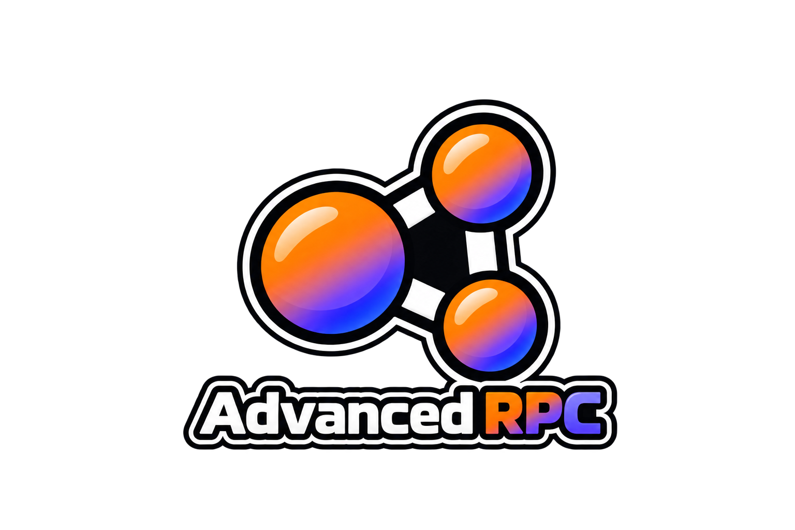

  

<h1 align="center">AdvancedRPC for BeamNG.drive</h1>

  Customize your Discord activity with live driving information, personal profiles, images, and more.

  <a href="https://www.beamng.com/resources/advancedrpc.39485/">BeamNG Repository</a>
  &middot;
  <a href="https://github.com/wolaryofficial/BMNG_AdvancedRPC/releases">GitHub Releases</a>
  &middot;
  <a href="#installation">Installation</a>
  &middot;
  <a href="#using-your-own-discord-application">Bridge setup</a>
  &middot;
  <a href="https://github.com/wolaryofficial/BMNG_AdvancedRPC/issues">Issues &amp; suggestions</a>

AdvancedRPC expands BeamNG.drive's Discord Rich Presence with editable text, automatic profiles, and live game data. Configure everything directly in **Esc → Mods → AdvancedRPC**.

**Version 1.1.0 · Tested with BeamNG.drive 0.40.3 · English and Russian interface**

**The bridge is optional.** The default **BeamNG Native** mode works through the game's built-in Discord connection. Use **Custom Application** mode and the bridge when you want to connect your own Discord application and use additional activity features.

## Features

- **Live game information:** map, vehicle, speed, RPM, gear, fuel, and session duration.
- **Custom profiles:** create, duplicate, reorder, import, and export profiles as JSON.
- **Automatic rules:** switch profiles by game context, map, vehicle, speed, or pause state.
- **Images and captions:** use asset keys or public HTTPS image URLs, add hover text, and assign images to specific maps and vehicles.
- **Text templates:** insert live variables, define fallback text, and rotate between multiple status messages.
- **Career support:** display career activities, balance, BeamXP, level, and profile name.
- **BeamMP support:** show available server information and player counts.
- **Split Screen:** choose which local player's vehicle and telemetry appear in your activity.
- **Ready presets:** create Career, Deliveries, BeamMP, and Split Screen profiles with optional automatic rules.
- **English and Russian:** follow the game language or choose an interface language in General. Your custom status text stays unchanged.
- **Image URL checks:** validate resolved links, detect length limits, and retry external image loading with an explanation of failures or game restrictions.
- **In-game preview:** inspect the active profile, resolved variables, and outgoing activity.

### New in 1.1.0

- Updated loading for BeamNG 0.40 without trying to load absent legacy or BeamMP extensions.
- Added Split Screen context and the `{local_player}`, `{local_players}`, and `{split_mode}` variables.
- Added interface language selection, ready presets, and image checks.
- Reduced vehicle telemetry requests: only fields used by the active or previewed profile are sampled, at most once per second. Unused telemetry stops automatically.
- Kept activity refreshes and automatic reconnection working across map, career, bridge, and Discord changes. A refresh at least every 30 seconds keeps an unchanged activity current.
- Existing profiles, rules, and Application ID are preserved when upgrading from 1.0.0.

## Connection modes

| Feature | BeamNG Native | Custom Application |
| --- | --- | --- |
| Bridge required | No | Yes, on Windows |
| Discord Application ID | Uses BeamNG's application | Your own Application ID |
| Custom text, profiles, images, and captions | Yes | Yes |
| Custom activity name, type, and member-list text | No | Yes |
| Clickable text and image links | No | Yes |
| Up to two buttons and Discord timers | No | Yes |
| BeamMP party size | No | When player count and capacity are available |

Discord controls the final appearance and visibility of activity fields.

## Installation

1. Open [AdvancedRPC on the official BeamNG Repository](https://www.beamng.com/resources/advancedrpc.39485/) and choose **Subscribe**, or search for **AdvancedRPC** in the in-game Repository and subscribe there.
2. Confirm that AdvancedRPC is enabled in the game's Mod Manager.
3. Start the Discord desktop app and keep it running while you play.
4. Enable Rich Presence and Discord Rich Presence in BeamNG's settings, and allow activity sharing in Discord.
5. Open **Esc → Mods → AdvancedRPC**. Leave **Connection mode** set to **BeamNG Native** to start without a bridge or an Application ID.

For manual installation, download the mod ZIP from the [BeamNG mod page](https://www.beamng.com/resources/advancedrpc.39485/) or [GitHub Releases](https://github.com/wolaryofficial/BMNG_AdvancedRPC/releases), then place it in the `mods` directory inside your active BeamNG.drive user folder. **Do not extract it.** See the [official installation guide](https://documentation.beamng.com/tutorials/mods/installing-mods/) if you need help finding the folder. Use the packaged mod ZIP, rather than GitHub's automatically generated source-code ZIP.

For a manual update, replace the previous AdvancedRPC ZIP instead of keeping both versions installed. When updating from CustomRPC, remove its old ZIP as well; existing settings and profiles are imported automatically.

## Profiles, languages, and Split Screen

Open **General → Interface and local player** to choose **Use game language**, **English**, or **Русский**. Automatic language selection uses Russian for a Russian game interface and English for other languages. This setting changes the mod interface, not your saved Discord text.

In **Profiles → Ready presets**, choose a template and click **Create from preset**. The new profile can be edited freely. If **Add an automatic rule** is enabled, its rule is inserted at the top of the Rules list. Enable automatic rules in General and keep specific rules, such as Deliveries, above broader ones, such as Career.

In Split Screen, set **Local player to track** to the player's number. Player 1 is the main player. The selected player's vehicle, configuration, speed, and requested telemetry are used throughout the activity. If that player has no vehicle, vehicle fields use their template fallback. One Discord account publishes one activity; the mod does not create separate activities for each local player.

## Using your own Discord application

The bridge connects AdvancedRPC to the Discord desktop app on Windows. It is distributed separately from the game mod and is not included in the BeamNG mod ZIP.

BeamNG's native Discord connection uses the game's own application. Its Lua API exposes activity updates but does not expose an Application ID setter. The bridge provides a separate local connection to Discord so AdvancedRPC can identify itself with your application. An Application ID identifies an application in the Developer Portal; it is not your Discord user ID.

1. Create an application in the [Discord Developer Portal](https://discord.com/developers/applications) and copy its **Application ID**.
2. Download **AdvancedRPC Bridge.exe** from [GitHub Releases](https://github.com/wolaryofficial/BMNG_AdvancedRPC/releases) and keep it in a permanent folder.
3. Run the bridge. Its icon appears in the Windows system tray.
4. In **Esc → Mods → AdvancedRPC → General**, select **Custom Application** and paste your Application ID.
5. Keep Discord and the bridge running while you play. Configure your profiles, images, buttons, and timers in the mod's settings.

Only the public Application ID is needed. No Discord account token, bot token, or client secret is required.

### Start with Windows

Right-click the bridge's tray icon and enable **Start with Windows**. Use the same option to disable automatic startup. If you move the executable, run it from its new location and enable startup again.

## Images and status text

In the **Images** tab, enter an asset key or a direct, publicly accessible HTTPS image URL. A link to an image-hosting page is not an image URL. Large and small images have separate captions, shown when someone hovers over them in Discord.

BeamNG Native uses BeamNG's asset keys, such as `lvl_italy`, or your image URLs. Custom Application uses assets uploaded to your own application or image URLs; BeamNG's asset keys are not shared with your application.

Use **Check images** in Images or Preview to check the resolved URLs, including map and vehicle overrides. **Retry images** repeats the check and reloads the preview. Native image sources have a 127-byte limit; Custom Application allows 512 bytes. Asset keys can only be confirmed in Discord.

BeamNG 0.40 can block external image loading and browser requests. In that case the checker reports the restriction or an unavailable preview; it cannot confirm the remote server's response. Discord fetches images independently, so a blocked preview does not mean the Discord image is broken. HTTP status and content-type checks are available when the game allows the request.

Text fields and image captions support `{variable}` and `{variable|fallback}`. For example:

<table>
  <thead>
    <tr>
      <th>Field</th>
      <th>Example</th>
    </tr>
  </thead>
  <tbody>
    <tr>
      <td>Details</td>
      <td><code>Driving {vehicle&#124;a vehicle}</code></td>
    </tr>
    <tr>
      <td>State</td>
      <td><code>{map&#124;Main menu} · {speed&#124;Parked}</code></td>
    </tr>
    <tr>
      <td>Large image caption</td>
      <td><code>Exploring {map&#124;BeamNG.drive}</code></td>
    </tr>
    <tr>
      <td>Career details</td>
      <td><code>Career · {career_activity&#124;Exploring}</code></td>
    </tr>
  </tbody>
</table>

The **Text** tab lists the available variables. Choose a profile in **General**, or assign it an automatic rule; editing or previewing a profile does not activate it.

## Troubleshooting

- **No activity appears:** check the mod's connection status, confirm Discord is running, and verify that Rich Presence and activity sharing are enabled.
- **Custom Application does not connect:** confirm the Application ID, start the bridge, and use **Reconnect** in the mod's settings.
- **An image is missing:** check its direct HTTPS URL or the asset key belonging to the selected application's mode. BeamNG may block external images in the preview even when Discord accepts them.
- **Updates seem delayed:** the default interval is 5 seconds and can be set from 1 to 60 seconds. Context changes and the 30-second refresh can send sooner. Discord may delay updates, and rapid changes are combined to respect its limits. Use Reconnect to request a fresh connection.
- **The wrong vehicle appears in Split Screen:** check Local player to track in General. The player number is one-based and does not follow whichever camera is focused.
- **Another presence mod is installed:** disable it to avoid competing updates to the same Discord activity.

## Compatibility and validation

Version 1.1.0 was checked in BeamNG.drive 0.40.3 with menu and free-roam transitions, a two-player Split Screen session, career entry and delivery mode, and automatic reconnection after restarting the bridge and Discord. Discord acknowledged the custom application's activities and external image URL. The native BeamNG API does not expose Discord acknowledgements.

BeamMP counters, context switching, and disconnect cleanup are covered by simulated API tests. A real BeamMP server session has not been verified for this release.

## Contributing

The source code is available in this repository. Improvements, bug fixes, and new features are welcome — including ideas the original author has not thought of yet. Share a suggestion, report a bug, or submit a pull request.

To build the mod ZIP and Windows bridge from source, run `./build.ps1` in PowerShell on Windows. Add `-CheckBridge` to run bridge and startup-registration tests, or `-PrepareGitHub` to prepare the upload folder. Build outputs are written to `dist`.

With BeamNG's MCP server running at `http://127.0.0.1:29292/mcp`, run `node tools/check.mjs` for Lua, settings, localization, and image-check tests. `node tools/live.mjs` exercises the in-game settings and restores the initial configuration afterward. Run UI checks from the main menu without unsaved edits.
